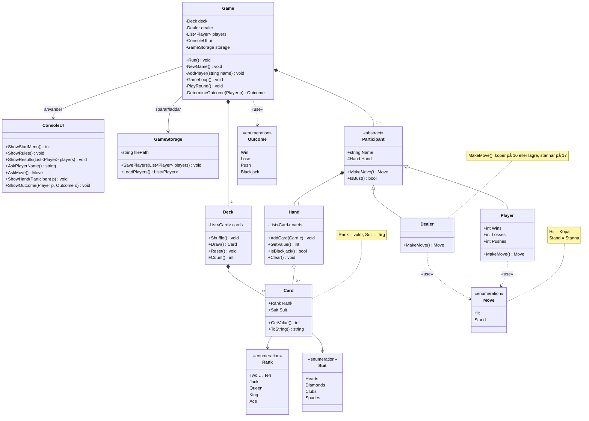

# KISIV Blackjack

## Vad programmet gör och hur man startar det
Ett tjugoett i konsolen för en till fem spelare mot en givare. Spelarnas resultat sparas i `players.txt` och finns kvar nästa gång programmet startas.

Starta med `dotnet run` i projektmappen.

## Klasser och hur de hänger ihop
*(fylls i gemensamt)*

## Vem som gjort vad

### Kim
- **Grund:** `Game` (meny, spelare och spelloop), `Round` (en giv: utdelning, köpregel, givarens tur och avgörande), `GameStorage` (sparar och läser `players.txt`) och `Outcome`.
- **Tillval 3, husregler från konfigurationsfil:** `RuleSet` och `RuleSetLoader` i `XRules/`.

### Ida
*(fylls i av Ida)*

### Sandra
*(fylls i av Sandra)*

### Veronica
*(fylls i av Veronica)*

### Ibuzor
*(fylls i av Ibuzor)*

## Regler
Spelet följer reglerna i uppgiften, med följande tillägg:

- Spelarnamn får inte vara tomma, längre än 20 tecken eller innehålla semikolon (;), eftersom sparfilen använder semikolon som avgränsare.

### Husregler (`rules.txt`)
Reglerna kan ändras i `rules.txt` utan att programmet byggs om. Filen läses när programmet startar.

| Inställning | Standard | Betyder |
|---|---|---|
| `DealerHitsSoft17` | `false` | Köper givaren på mjuk 17? |
| `NumberOfDecks` | `1` | Antal kortlekar |
| `ReshuffleThreshold` | `15` | Ny lek när färre än så här många kort är kvar |
| `NaturalBeatsThreeCard21` | `true` | Vinner naturlig 21 över en 21 av tre kort? Om `false` blir det lika |

Saknas filen används standardreglerna, och programmet säger till. En felstavad regel, en trasig rad eller ett ogiltigt värde (till exempel `NumberOfDecks=0`) ger en varning, och standardvärdet används för just den regeln. `ReshuffleThreshold` måste vara minst 15, så att korten inte tar slut mitt i en runda.

## Kända brister
- Med en lek och `ReshuffleThreshold` på 52 eller mer blandas leken om varje runda.
- Trasiga rader i `players.txt` hoppas över vid inläsning och försvinner när filen sparas igen.
- `Round.Settle()` räknar upp statistiken varje gång den anropas. Anropas den två gånger för samma spelare räknas resultatet dubbelt.
Räknaren kan nollställas mitt i en runda i nödfall, och räkningen uppdateras bara mellan rundorna.

## Klassdiagram

