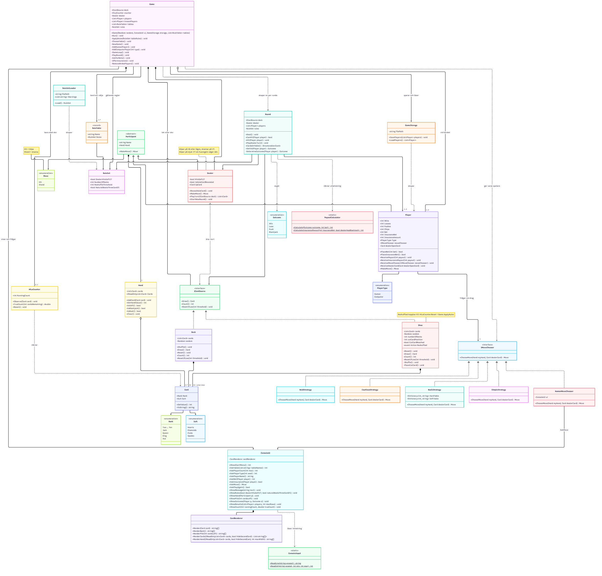

# KISIV Blackjack

## Vad programmet gör och hur man startar det

Ett tjugoett i konsolen för en till fem spelare mot en givare. Spelarnas resultat sparas i `players.txt` och finns kvar nästa gång programmet startas.

Starta med `dotnet run` i projektmappen.

## Klasser och hur de hänger ihop

Programmet är uppdelat så att **regelklasserna aldrig pratar med användaren**. All in- och utmatning sker i `ConsoleUI`. Det gör att presentationen, spelarnas beslut och husreglerna kan bytas ut utan att spelreglerna ändras.

### Flödet

`Program` läser in borden (`RuleSetLoader` → `RuleSet`) och startar `Game`. `Game` visar menyn, låter spelaren välja bord och spelare, och skapar en `Round` för varje giv. `Round` delar ut kort från leken eller skon, låter spelarna och givaren spela, och avgör utfallet. Efter rundan sparar `GameStorage` resultaten.

### Översikt

| Område | Klasser | Ansvar |
|---|---|---|
| Spelet | `Game`, `Round`, `GameStorage`, `Outcome`, `Move` | `Game` styr menyn och spelloopen. `Round` är en giv utan in- och utmatning. `GameStorage` sparar spelare, statistik och marker i `players.txt` |
| Kort | `Card`, `Rank`, `Suit`, `Hand` | Ett kort har valör och färg. `Hand` räknar ut sitt värde och vet om den är mjuk, spräckt eller naturlig 21 |
| Kortkällor | `ICardSource`, `Deck`, `Shoe`, `HiLoCounter` | `Deck` är en lek, och `Shoe` är flera lekar med skiljekort. Båda uppfyller `ICardSource`, så att `Round` inte behöver veta vilken som används. `HiLoCounter` räknar kort men ändrar ingenting i spelet |
| Deltagare | `Participant`, `Player`, `Dealer`, `PlayerType` | `Player` och `Dealer` ärver `Participant` (namn och hand). `Dealer` följer en fast regel, och `Player` frågar sin beslutsfattare |
| Beslut | `IMoveChooser`, `HumanMoveChooser`, `SimpleStrategy`, `BasicStrategy`, `CautiousStrategy`, `BoldStrategy` | Vem som väljer köpa eller stanna. Människor och datorer kan sitta vid samma bord och bytas ut utan att `Player` ändras |
| Husregler | `RuleSet`, `RuleSetLoader`, `RuleTable` | Reglerna läses från `rules.txt` och `rules-*.txt`. Varje fil blir ett bord |
| Insatser | `PayoutCalculator` | Räknar ut utbetalningen för varje utfall |
| Konsolen | `ConsoleUI`, `ConsoleInput`, `CardRenderer` | All kontakt med användaren. `CardRenderer` ritar korten som rutor och returnerar raderna, så att `ConsoleUI` kan sätta dem bredvid varandra |

### Två gränssnitt som gör programmet utbytbart

- **`IMoveChooser`**: samma anrop, `ChooseMove`, men olika beteende för människa och olika datorstrategier.
- **`ICardSource`**: `Round` och `Dealer` drar kort på samma sätt oavsett om det är en lek eller en sko.

## Vem som gjort vad

### Kim

- **Grund:** `Game` (meny, 1–5 spelare där samma namn inte kan sitta vid bordet två gånger, sparade spelare återanvänds, spelloop som spelar runda efter runda och sparar efter varje runda), `Round` (utbruten ur `Game`; en giv: utdelning, köpregel, givarens tur och avgörande, utan någon in- eller utmatning), `GameStorage` (sparar och läser `players.txt`; en saknad fil ger en tom lista och trasiga rader hoppas över) och `Outcome`.

- **Tillval 3, husregler från konfigurationsfil:** `RuleSet` (håller de fyra reglerna, med grundreglerna som standardvärden), `RuleSetLoader` (läser `rules.txt` rad för rad; en saknad fil, en felstavad regel eller ett ogiltigt värde ger en varning och standardvärdet används, så programmet kraschar aldrig på grund av filen), `RuleTable` (ett bord: namn och regler). Varje fil som heter `rules-*.txt` blir ett eget bord som man väljer vid nytt spel (`Game.ChooseTable`, `ConsoleUI.AskTable`), och bordets husregler visas direkt. Sju tester för `RuleSetLoader` i `Test.cs`.

- **Ändrat i gemensam kod för tillvalet:** `Dealer` (köper på mjuk 17 om regeln säger det), `Deck.ResetIfLow` (gränsen för omblandning skickas in i stället för det fasta talet 15), `Round` (regeln om naturlig 21 mot 21 av tre kort), `Game` (bygger lek eller sko och givare efter bordets regler i `ApplyRules`) och `Program.cs` (läser in borden när programmet startar).

### Ida

- **Grund:** `Hand` (håller varje spelares kort, inklusive givarens; räknar ut värdet, mjuk hand, spräckt hand och naturlig 21), `IMoveChooser` (gränssnitt som används vid val av drag, tar in spelarens hand och givarens öppna kort), `HumanMoveChooser` (skickar frågan om drag till den mänskliga spelaren), `Player` (håller spelarens namn, statistik och marker; frågar sin beslutsfattare när det är dags att välja drag).

- **Tillval 4, satsningar och marker:** `PayoutCalculator` (räknar ut utbetalningen utifrån utgången i spelet, räknar även ut försäkringsutbetalning), `Player.PlaceBet` (drar insatsen från markerna, nekas om den är 0 eller överstiger spelarens marker), `Player.PlaceInsuranceBet` (drar försäkringsinsatsen från markerna, nekas om den är 0, överstiger spelarens marker eller om en försäkringsinsats redan dragits en gång i rundan), `Player.ReceivePayout` (ger spelaren utbetalningen efter rundan), `Player.ReceiveInsurancePayout` (ger spelaren försäkringsutbetalningen efter rundan), `ConsoleUI.AskBet` (frågar den mänskliga spelaren hur mycket hen vill satsa), `ConsoleUI.AskInsurance` (frågar den mänskliga spelaren om hen vill lägga en försäkring), `Game.AskForBets` (frågar spelarna om deras insatser inför varje runda), `Game.RemoveBrokePlayers` (tar bort spelare utan marker innan nästa runda), `Game.OfferInsurance` (frågar den mänskliga spelaren om hen vill lägga försäkring när givarens öppna kort är ett ess), `Round.Settle` (utökad från Kim; räknar ut utbetalningen med `PayoutCalculator` och ger den till spelaren, kollar om spelaren lagt försäkring och ger i så fall försäkringsutbetalningen till spelaren), `GameStorage` (utökad från Kim; sparar och läser marker i `players.txt`).

### Sandra

- **Grund:** `RevealHoleCard`och `IsHoleCardReveald` (hålkortet vänds när alla spelare är klara), `MakeMove`(givaren köper på 16 eller lägre och stannar på 17, även mjuk 17), `PlayTurn`(givaren spelar alltid färdigt och väljer aldrig själv), `StartNewRound`(tömmer handen och döljer hålkortet inför varje ny runda).

- **Tillval 2, datorspelare med strategi:** `SimpleStrategy` (köper så länge handen är under 17), `BasicStrategy` (följer grundstrategin genom att slå upp draget i en tabell utifrån handens värde, om handen är mjuk eller hård, och givarens öppna kort),`CautiousStrategy` (stannar på 12 eller mer), `BoldStrategy` (köper tills handen är 19 eller mer), `AskPlayerType` (frågar för varje plats om det är en människa eller en dator), `AddHumanPlayer`och `AddComputerPlayer` (skapar spelaren och ger den rätt strategi via `ReceiveMoveChooser`), `PlayerType` (skiljer på människa och dator).

### Veronica

- **Grund:** `Card` (ett kort med valör och färg; räknar ut kortets värde och visar kortet som svensk text), `Rank` och `Suit` (valörer och färger), `Deck` (en lek med 52 kort som blandas med Fisher–Yates och den gemensamma `Random`; blandas om när färre än `ReshuffleThreshold` kort är kvar).

- **Tillval 5, sko med flera lekar och korträkning:** `Shoe` (flera kortlekar blandade till en hög; lägger ett skiljekort på slumpmässig plats i den bakre fjärdedelen och blandar om mellan rundorna när det har dragits; meddelar med eventet `Reshuffled` när skon blandats om), `ICardSource` (gränssnitt för det man drar kort ifrån, implementeras av `Deck` och `Shoe` så att `Round` och `Dealer` inte behöver veta vilken som används), `HiLoCounter` (räknar visade kort enligt Hi-Lo och räknar ut löpande och sann räkning; observerar bara och ändrar inget i spelet), `ConsoleUI.ShowCount` (visar löpande och sann räkning och om läget är gynnsamt, neutralt eller ogynnsamt), `Round` (utökad från Kim; tar emot `ICardSource`, och `CardsOnTable` lämnar ut alla kort på bordet när rundan är slut), `Game` (utökad från Kim; väljer lek eller sko utifrån `NumberOfDecks`, skapar korträknaren och visar den korten efter varje runda), `Dealer.PlayTurn` (utökad; tar emot `ICardSource`).

### Ibuzor

- **Grund:** `ConsoleUI` och `ConsoleInput` i `XConsoleUI/`, där all in- och utmatning ligger så att regelklasserna aldrig anropar `Console`. `ConsoleInput` läser och validerar heltal och text och ger begripliga felmeddelanden. `ConsoleUI` har startmenyn, frågorna om antal spelare, namn, köp/stanna och ny runda, spelets nio grundregler (`ShowRules`), visning av en hand med dolt hålkort (`ShowHand`), rundans utfall på svenska (`ShowOutcome`) och resultattabellen (`ShowResults`). Jag skrev också startkoden i `Program.cs` och namnreglerna i README.

- **Tillval 1, kortgrafik i konsolen:** `CardRenderer` i `XConsoleUI/`. Varje kort ritas som en ram på 9 × 7 tecken med valören i två hörn och färgen i mitten. Klädda kort har schackglyferna ♞ ♛ ♚. Renderaren returnerar `string[]` så att `ConsoleUI` kan sätta ihop flera kort bredvid varandra och radbryta efter konsolens bredd. Hjärter och ruter färgas röda och klöver och spader grå i `ConsoleUI`, inte i renderaren. Givarens hålkort ritas med en baksida där KISIV-logotypen bildar ett X. Kortleken ritas som en hög (`RenderPile`, `ShowPile`) som visas i början av varje runda. Resultattabellen visar de fem spelarna med flest marker.
- **Inte gjort:** Kortgrafik 7 (animation av kortbunten).

## Regler

Spelet följer reglerna i uppgiften, med följande tillägg:

- Spelarnamn får inte vara tomma, längre än 20 tecken eller innehålla semikolon (;), eftersom sparfilen använder semikolon som avgränsare.
- Naturlig tjugoett betalar 3:2. Vinsten avrundas uppåt när insatsen är udda. En insats på 5 marker ger vinst 7,5, som blir 8.
- Spelaren erbjuds försäkring om givarens öppna kort är ett ess. Försäkringen är halva insatsen och avrundas nedåt - är insatsen 5 marker blir försäkringen 2 marker. Om spelaren inte har råd kan hen inte försäkra. Datorspelare blir inte tillfrågade om försäkring.
- Har givaren blackjack får man tillbaka tre gånger försäkringsinsatsen - har givaren *inte* blackjack förlorar man försäkringen. Med 2 marker som försäkring blir det 6 tillbaka, alltså 4 i vinst. Uppgörelsen sker efter att givaren spelat klart.
- En sparad spelare med 0 marker tilldelas nya startmarker (200, `Player.StartingChips`) när hen sätter sig vid bordet.
- Med `NumberOfDecks=1` används en vanlig lek. Med fler lekar används en sko med skiljekort.
- Skiljekortet läggs när mellan 1 och en fjärdedel av skons kort är kvar. När det dras spelas rundan färdigt, och skon blandas om inför nästa runda. `ReshuffleThreshold` gäller även för skon, som en säkerhetsspärr.
- Korträknaren visas bara när skon används. Den räknar in korten när rundan är slut, då även hålkortet är vänt, och nollställs när skon blandas om.
- Sann räkning är löpande räkning delad med antalet kvarvarande lekar. Indikatorn visar gynnsamt vid +2 eller mer och ogynnsamt vid −2 eller mindre.

### Husregler (`rules.txt`)

Reglerna kan ändras i `rules.txt` utan att programmet byggs om. Filen läses när programmet startar.

| Inställning | Standard | Betyder |
|---|---|---|
| `DealerHitsSoft17` | `false` | Köper givaren på mjuk 17? |
| `NumberOfDecks` | `1` | Antal kortlekar |
| `ReshuffleThreshold` | `15` | Ny lek när färre än så här många kort är kvar |
| `NaturalBeatsThreeCard21` | `true` | Vinner naturlig 21 över en 21 av tre kort? Om `false` blir det lika |

Saknas filen används standardreglerna, och programmet säger till. En felstavad regel, en trasig rad eller ett ogiltigt värde (till exempel `NumberOfDecks=0`) ger en varning, och standardvärdet används för just den regeln. `ReshuffleThreshold` måste vara minst 15, så att korten inte tar slut mitt i en runda.
Spelet blandar också om före given om det finns färre än (antal spelare + 1) × 6 kort kvar, även om `ReshuffleThreshold` är lägre. Det gäller både en lek och en sko. Med 5 spelare blandas alltså om vid 36 kort, och i en sko bestämmer skiljekortet bara när det ligger på fler än 36 kort kvar.

#### Bord (regelpaket)

Varje fil som heter `rules-*.txt` blir ett eget bord. Man väljer bord när man startar ett nytt spel, och reglerna för bordet visas direkt. Ett nytt bord är bara en ny textfil, utan ändringar i koden.

| Bord | Fil | Regler |
|---|---|---|
| Standard | `rules.txt` | Grundreglerna |
| Tuff | `rules-tuff.txt` | 8 lekar, givaren köper på mjuk 17, 21 mot 21 blir lika, ny sko redan under 60 kort |
| Vegas | `rules-vegas.txt` | 6 lekar, givaren köper på mjuk 17 |

Vid Vegas avgör skiljekortet när skon blandas om, som på ett riktigt kasino, och `ReshuffleThreshold` är bara ett skydd. Vid Tuff blandas skon om redan under 60 kort. Då spelas en mindre del av skon, och korträkning ger mindre fördel.

## Kända brister

- Spärren (antal spelare + 1) × 6 gör att en enda lek blandas om nästan varje runda med många spelare, och i en sko tar den över från skiljekortet när det ligger lågt. En runda som drar ovanligt många kort kan fortfarande ta slut på leken, men det är mycket ovanligare än förut.

- En runda med många spelare kan i sällsynta fall använda fler än 15 kort. Då byggs en ny lek mitt i rundan, och samma kort kan finnas två gånger på bordet.

- Trasiga rader i `players.txt` hoppas över vid inläsning och försvinner när filen sparas igen.

- `Round.Settle()` räknar upp statistiken varje gång den anropas. Anropas den två gånger för samma spelare räknas resultatet dubbelt.

- `Player.Chips`, `Player.Bet` och `Player.InsuranceBet` är publika, så andra klasser kan ändra markerna och insatserna direkt, till exempel `Game.AddPlayer` när en spelare får nya startmarker.

- När givarens öppna kort är ett ess erbjuds den mänskliga spelaren en försäkring. Till skillnad från ett riktigt kasino kollas inte hålkortet direkt, utan rundan spelas färdigt i vanlig ordning. Försäkringen avgörs när givaren spelat klart.

- Om det händer med skon nollställs korträknaren mitt i rundan.

- Korträkningen uppdateras mellan rundorna, inte för varje kort som visas.

## Klassdiagram

Diagrammet visar de viktigaste fälten och metoderna, inte alla privata hjälpmetoder. `Program.cs` har inga egna klasser. Där läses borden in med `RuleSetLoader`, och sedan skapas `Game`.

```mermaid
classDiagram
    direction TB

    %% ---------- Spelet ----------
    class Game {
        -ICardSource deck
        -HiLoCounter counter
        -Dealer dealer
        -List~Player~ players
        -List~Player~ knownPlayers
        -List~RuleTable~ tables
        -RuleSet rules
        +Game(Random random, ConsoleUI ui, GameStorage storage, List~RuleTable~ tables)
        +Run() void
        -ApplyRules(RuleSet tableRules) void
        -ChooseTable() void
        -NewGame() void
        -AddHumanPlayer() void
        -AddComputerPlayer(int type) void
        -GameLoop() void
        -PlayRound() void
        -AskForBets() void
        -OfferInsurance() void
        -RemoveBrokePlayers() void
    }

    class Round {
        -ICardSource deck
        -Dealer dealer
        -List~Player~ players
        -RuleSet rules
        +Deal() void
        +CanHit(Player player) bool
        +Hit(Player player) void
        +PlayDealerTurn() void
        +CardsOnTable() IEnumerable~Card~
        +Settle(Player player) Outcome
        -DetermineOutcome(Player player) Outcome
    }

    class GameStorage {
        -string filePath
        +SavePlayers(List~Player~ players) void
        +LoadPlayers() List~Player~
    }

    class Outcome {
        <<enumeration>>
        Win
        Lose
        Push
        Blackjack
    }

    %% ---------- Deltagare ----------
    class Participant {
        <<abstract>>
        +string Name
        +Hand Hand
        +MakeMove() Move*
    }

    class Player {
        +int Wins
        +int Losses
        +int Pushes
        +int Chips
        +int Bet
        +int InsuranceBet
        +int InsuranceAmount
        +PlayerType Type
        -IMoveChooser moveChooser
        -Card dealerOpenCard
        +PlaceBet(int bet) bool
        +PlaceInsuranceBet() bool
        +ReceivePayout(int payout) void
        +ReceiveInsurancePayout(int payout) void
        +ReceiveMoveChooser(IMoveChooser moveChooser) void
        +ReceiveDealerCard(Card dealerOpenCard) void
        +MakeMove() Move
    }

    class Dealer {
        -bool hitsSoft17
        +bool IsHoleCardRevealed
        +Card UpCard
        +RevealHoleCard() void
        +MakeMove() Move
        +PlayTurn(ICardSource deck) List~Card~
        +StartNewRound() void
    }

    class Hand {
        -List~Card~ cards
        +IReadOnlyList~Card~ Cards
        +AddCard(Card card) void
        +GetHandValue() int
        +IsSoft() bool
        +IsBlackjack() bool
        +IsBust() bool
        +Clear() void
    }

    class PlayerType {
        <<enumeration>>
        Human
        Computer
    }

    class Move {
        <<enumeration>>
        Hit
        Stand
    }

    %% ---------- Val av drag (strategier) ----------
    class IMoveChooser {
        <<interface>>
        +ChooseMove(Hand myHand, Card dealerCard) Move
    }
    class HumanMoveChooser {
        -ConsoleUI ui
        +ChooseMove(Hand myHand, Card dealerCard) Move
    }
    class SimpleStrategy {
        +ChooseMove(Hand myHand, Card dealerCard) Move
    }
    class BasicStrategy {
        -Dictionary~int, string~ HardTable
        -Dictionary~int, string~ SoftTable
        +ChooseMove(Hand myHand, Card dealerCard) Move
    }
    class CautiousStrategy {
        +ChooseMove(Hand myHand, Card dealerCard) Move
    }
    class BoldStrategy {
        +ChooseMove(Hand myHand, Card dealerCard) Move
    }

    %% ---------- Kort, lek och sko ----------
    class ICardSource {
        <<interface>>
        +Draw() Card
        +Count() int
        +ResetIfLow(int threshold) void
    }

    class Deck {
        -List~Card~ cards
        -Random random
        +Shuffle() void
        +Draw() Card
        +Reset() void
        +Count() int
        +ResetIfLow(int threshold) void
    }

    class Shoe {
        -List~Card~ cards
        -Random random
        -int numberOfDecks
        -int cutCardPosition
        +bool CutCardReached
        +event Action Reshuffled
        +Reset() void
        +Draw() Card
        +Count() int
        +ResetIfLow(int threshold) void
        -Shuffle() void
        -PlaceCutCard() void
    }

    class HiLoCounter {
        +int RunningCount
        +Observe(Card card) void
        +TrueCount(int cardsRemaining) double
        +Reset() void
    }

    class Card {
        +Rank Rank
        +Suit Suit
        +GetValue() int
        +ToString() string
    }

    class Rank {
        <<enumeration>>
        Two … Ten
        Jack
        Queen
        King
        Ace
    }

    class Suit {
        <<enumeration>>
        Hearts
        Diamonds
        Clubs
        Spades
    }

    %% ---------- Satsningar ----------
    class PayoutCalculator {
        <<static>>
        +Calculate(Outcome outcome, int bet) int$
        +CalculateInsurancePayout(int insuranceBet, bool dealerHasBlackjack) int$
    }

    %% ---------- Husregler ----------
    class RuleSet {
        +bool DealerHitsSoft17
        +int NumberOfDecks
        +int ReshuffleThreshold
        +bool NaturalBeatsThreeCard21
    }

    class RuleSetLoader {
        -string filePath
        +List~string~ Warnings
        +Load() RuleSet
    }

    class RuleTable {
        <<record>>
        +string Name
        +RuleSet Rules
    }

    %% ---------- Konsol ----------
    class ConsoleUI {
        -CardRenderer cardRenderer
        +ShowStartMenu() int
        +AskTable(List~string~ tableNames) int
        +AskPlayerCount(int max) int
        +AskPlayerType(int seat) int
        +AskPlayerName() string
        +AskBet(Player player) int
        +AskInsurance(Player player) bool
        +AskMove() Move
        +AskPlayAgain() bool
        +ShowMessage(string text) void
        +ShowRules(bool dealerHitsSoft17, bool naturalBeatsThreeCard21) void
        +ShowHand(Participant p) void
        +ShowPile(int cardsLeft) void
        +ShowOutcome(Player p, Outcome o) void
        +ShowResults(List~Player~ players, int maxRows) void
        +ShowCount(int runningCount, double trueCount) void
    }

    class ConsoleInput {
        <<static>>
        +ReadLine(string prompt) string$
        +ReadInt(string prompt, int min, int max) int$
    }

    class CardRenderer {
        +Render(Card card) string[]
        +RenderBack() string[]
        +RenderPile(int cardsLeft) string[]
        +RenderCards(IReadOnlyList~Card~ cards, bool hideSecondCard) List~string[]~
        +RenderHand(IReadOnlyList~Card~ cards, bool hideSecondCard, int maxWidth) string[]
    }

    %% ---------- Relationer ----------
    Game --> ConsoleUI : visar och frågar
    Game --> GameStorage : sparar och läser
    Game --> "1..*" RuleTable : bord att välja
    Game --> RuleSet : gällande regler
    Game *-- ICardSource : lek eller sko
    Game *-- Dealer
    Game o-- "1..5" Player : vid bordet
    Game *-- "0..1" HiLoCounter : bara med sko
    Game ..> Round : skapar en per runda
    Game ..> IMoveChooser : ger varje spelare

    Round --> ICardSource
    Round --> Dealer
    Round --> "1..5" Player
    Round --> RuleSet
    Round ..> PayoutCalculator : räknar utbetalning
    Round ..> Outcome : avgör

    Participant <|-- Player
    Participant <|-- Dealer
    Participant *-- "1" Hand
    Participant ..> Move

    Player --> "1" IMoveChooser : frågar om drag
    Player --> PlayerType
    Dealer ..> ICardSource : drar kort

    IMoveChooser <|.. HumanMoveChooser
    IMoveChooser <|.. SimpleStrategy
    IMoveChooser <|.. BasicStrategy
    IMoveChooser <|.. CautiousStrategy
    IMoveChooser <|.. BoldStrategy
    HumanMoveChooser --> ConsoleUI : AskMove

    ICardSource <|.. Deck
    ICardSource <|.. Shoe
    Deck *-- "52" Card
    Shoe *-- "52 × antal lekar" Card
    Hand o-- "0..*" Card
    Card --> Rank
    Card --> Suit
    HiLoCounter ..> Card : räknar

    GameStorage ..> Player : skapar
    RuleSetLoader ..> RuleSet : skapar
    RuleTable --> RuleSet

    ConsoleUI *-- CardRenderer
    ConsoleUI ..> ConsoleInput : läser inmatning

    %% ---------- Kommentarer ----------
    note for Shoe "Reshuffled kopplas till HiLoCounter.Reset i Game.ApplyRules"
    note for Dealer "Köper på 16 eller lägre, stannar på 17.<br>Köper på mjuk 17 om husregeln säger det."
    note for Move "Hit = köpa<br>Stand = stanna"
```

